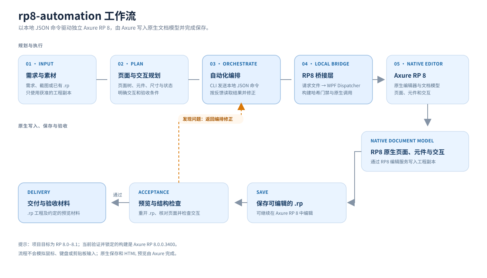

# rp8-automation 工作流详解

这份说明按一次完整的 RP8 自动化任务，解释输入、编排、桥接、原生编辑、保存与验收之间的关系。

## 一、工作流总览

1. 提供需求、截图或获准处理的现有 RP 工程。
2. 规划页面树、元件层级、布局、状态、交互与验收条件。
3. 自动化编排器把具体操作转换为本地 JSON 请求，由命令行客户端发送。
4. 独立 RP8 宿主读取请求，在 RP8 的 WPF UI Dispatcher 上执行版本绑定的原生编辑调用。
5. Axure RP 8 将变更写入工程文档模型，再由 Axure 原生保存器保存为可继续编辑的 .rp 文件。
6. 重开工程检查结构，并通过 Axure HTML 生成器预览交互；有问题时回到编排步骤修正。
7. 验收通过后交付 .rp 工程以及双方约定的预览或验收材料。

## 二、详细构成

### 1. 需求与素材

输入可以是自然语言需求、页面截图、现有 RP 工程或这些材料的组合。开始前应确认工程的来源和使用权限，并说明需要保留的页面、品牌样式、内容和交互。

如果提供现有 .rp 文件，启动器先将其复制到唯一的本机工作目录。后续编辑针对分配给本次会话的副本进行；请把保存后的副本视为本次输出，并按教程中的路径查找。

### 2. 页面与交互规划

先把需求拆成可执行、可检查的项目，例如：

- 页面清单、页面层级、页面名称和页面跳转关系。
- 每页的元件树、元件名称、文本、位置、尺寸和样式。
- 输入框、按钮、复选框等控件的初始状态和变化规则。
- Axure 事件、用例、条件与动作。
- 验收项，例如页面存在、元件属性正确、保存后可重开、浏览器预览中的交互符合预期。

把页面规格和验收条件写清楚，可以减少反复修改，也能区分结构完成和交互通过。

### 3. 自动化编排与 JSON CLI

编排层负责把计划转换成适配器支持的命令，并按依赖关系安排顺序。例如先创建页面，再创建元件，然后设置样式和交互，最后保存与检查。

live/live_cli.py 从本机的 live/session.json 读取当前会话路径。每个 JSON 请求先写入临时文件，再原子改名为请求文件，避免宿主读到只写了一半的内容。请求和响应留在本机工作目录中。

### 4. RP8 桥接层与独立宿主

打开独立RP8.exe 是由 live/build.cmd 编译的启动器。它接收一个 .rp 路径，将工程复制到唯一工作目录，然后启动独立的 RP8Live.next.exe x86 宿主。若专用宿主已经运行，启动器会复用现有实例，不激活窗口，也不切换其当前文件。

RP8 宿主轮询会话的请求目录，把命令交给 WPF Dispatcher。执行前会校验 Axure 可执行文件和相关程序集的 SHA-256；哈希不匹配时拒绝进入编辑流程。

适配器通过 .NET 反射访问 RP8 内部程序集、原生客户端对象、编辑器服务和编辑事务。这是针对已验证构建的社区适配器，不是 Axure 官方 SDK。

### 5. RP8 原生文档编辑

编辑调用在 RP8 进程内运行，修改 Axure 原生页面、元件和交互。支持范围包括页面导航和创建、常见元件的创建与属性修改、白名单样式、受支持的原生事件/条件/动作，以及结构读取。

这和生成图片或只写 HTML 原型不同：输出仍然是 RP8 可以继续打开和编辑的原生工程。程序不会模拟鼠标、键盘或剪贴板输入。

### 6. 保存、预览与验收

保存命令调用 Axure 原生保存入口；另存为操作也由 RP8 执行。HTML 预览调用 Axure 自带生成器。建议分别完成以下检查：

1. 保存后关闭或重开 .rp，确认工程可以被 Axure 打开。
2. 检查页面树、元件树、文本、位置、尺寸和交互配置。
3. 使用 Axure 生成 HTML 预览，在浏览器中检查页面布局与交互行为。
4. 将每一项验收结果与约定的需求逐条对照，并整理预览或截图材料。

成功调用保存、生成预览或读取结构，只能证明相应步骤成功，不能代替其余验收。

### 7. 问题回路与交付

若页面结构、属性或交互不符合预期，将具体问题写成可复现的修改项，返回自动化编排步骤，再执行、保存和复验。确认通过后，交付保存后的 .rp 工程以及约定的 HTML 预览、截图或验收记录。

## 三、组件索引

| 组件 | 职责 |
| --- | --- |
| live/live_cli.py | 发送 JSON 请求并读取会话响应 |
| live/RP8LiveLauncher.cs | 建立工作副本并启动专用 RP8 宿主 |
| live/RP8Live.cs | 页面导航、元件读写、保存、截图和 HTML 导出 |
| live/RP8Styling.cs | 样式白名单、填充、阴影和可编辑矢量路径 |
| live/RP8Interactions.cs | 原生事件、用例、条件和动作的创建与读取 |
| live/build.cmd | 构建启动器和宿主 |

## 四、兼容性边界

项目目标是 Axure RP 8.0–8.1。当前验证并按哈希锁定的构建为 Windows x86 上的 Axure RP 8.0.0.3400；其他 8.0 或 8.1 构建尚未逐一验证。请阅读[兼容性与能力范围](COMPATIBILITY.md)及[详细使用教程](TUTORIAL.md)，并使用有权运行的 Axure 安装。

