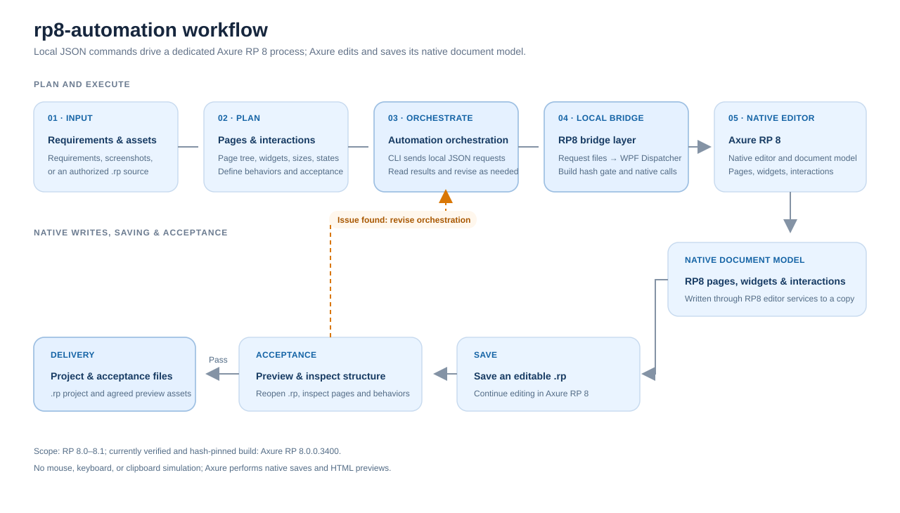

# rp8-automation Workflow Guide

This guide explains how a complete RP8 automation task moves from inputs and orchestration through the bridge, native editing, saving, and acceptance.

## 1. Workflow at a glance

1. Provide requirements, screenshots, or an existing RP project that you are authorized to process.
2. Plan the page tree, widget hierarchy, layout, states, interactions, and acceptance criteria.
3. The orchestrator translates each operation into a local JSON request and sends it through the CLI.
4. A dedicated RP8 host reads the request and executes version-pinned native editing calls on the RP8 WPF UI Dispatcher.
5. Axure RP 8 writes changes into its document model and its native saver stores an editable .rp file.
6. Reopen the project to inspect its structure, then preview interactions with Axure's HTML generator. Send issues back to orchestration for revision.
7. After acceptance, deliver the .rp project and the agreed preview or acceptance materials.

## 2. Components in detail

### 2.1 Requirements and assets

Inputs can include natural-language requirements, page screenshots, an existing RP project, or a combination of these. Confirm that the project may be used and identify pages, brand styles, content, and interactions that must be preserved.

When an existing .rp file is supplied, the launcher first copies it into a unique local working directory. Editing is limited to the copy assigned to that session. Treat the saved copy as the output of the task and use the tutorial to locate it.

### 2.2 Page and interaction planning

Turn requirements into actions that can be implemented and checked:

- Page list, hierarchy, names, and navigation links.
- Widget tree, names, text, position, dimensions, and styles for each page.
- Initial states and state changes for inputs, buttons, checkboxes, and other controls.
- Axure events, cases, conditions, and actions.
- Acceptance criteria such as page presence, correct widget properties, successful reopening after save, and expected behavior in browser preview.

Clear page specifications and acceptance criteria reduce rework and distinguish structural completion from interaction acceptance.

### 2.3 Automation orchestration and JSON CLI

The orchestration layer translates the plan into supported adapter commands and orders them by dependency. For example, create pages first, then widgets, then styles and interactions, and finally save and inspect.

live/live_cli.py reads the active session path from the local live/session.json. Each JSON request is written to a temporary file and atomically renamed into the request directory so that the host does not read a partially written request. Requests and responses stay in the local working directory.

### 2.4 RP8 bridge and dedicated host

打开独立RP8.exe is the launcher built by live/build.cmd. It accepts an .rp path, copies the project into a unique working directory, and starts the dedicated x86 RP8Live.next.exe host. If a dedicated host is already running, the launcher reuses it without activating its window or switching the active file.

The RP8 host polls the session request directory and dispatches each command to the WPF Dispatcher. Before editing, it verifies the SHA-256 hashes of the Axure executable and related assemblies. A hash mismatch blocks the editing workflow.

The adapter uses .NET reflection to access RP8 internal assemblies, native client objects, editor services, and editing transactions. It is a community adapter for the verified build, not an official Axure SDK.

### 2.5 Native RP8 document editing

Editing calls run inside the RP8 process and modify native Axure pages, widgets, and interactions. Supported areas include page navigation and creation, common widget creation and property updates, allowlisted styles, supported native events/conditions/actions, and structure inspection.

This differs from generating images or writing an HTML-only prototype: the output remains a native project that RP8 can open and continue editing. The program does not simulate mouse, keyboard, or clipboard input.

### 2.6 Saving, preview, and acceptance

The save command calls Axure's native save entry point; Save As is also performed by RP8. HTML preview invokes Axure's own generator. Complete these checks separately:

1. Close and reopen the saved .rp file in Axure to verify that the project opens.
2. Inspect the page tree, widget tree, text, position, dimensions, and interaction configuration.
3. Generate an HTML preview with Axure and inspect layout and interaction behavior in a browser.
4. Compare each result with the agreed requirements and prepare preview or screenshot evidence.

A successful save, preview-generation, or structure-read command proves only that step; it does not replace the other acceptance checks.

### 2.7 Issue loop and delivery

When structure, properties, or interactions do not match expectations, describe the issue as a reproducible change request, return to orchestration, then execute, save, and check again. Once accepted, deliver the saved .rp project and the agreed HTML preview, screenshots, or acceptance notes.

## 3. Component index

| Component | Responsibility |
| --- | --- |
| live/live_cli.py | Sends JSON requests and reads session responses |
| live/RP8LiveLauncher.cs | Creates the working copy and starts the dedicated RP8 host |
| live/RP8Live.cs | Page navigation, widget reads/writes, save, capture, and HTML export |
| live/RP8Styling.cs | Style allowlist, fills, shadows, and editable vector paths |
| live/RP8Interactions.cs | Creates and reads native events, cases, conditions, and actions |
| live/build.cmd | Builds the launcher and host |

## 4. Compatibility boundary

The project targets Axure RP 8.0–8.1. Only a specific Windows x86 build 3400 binary set is verified and SHA-256-pinned; other binary sets and builds remain unverified. The official release label is 8.1.0.3400, while the signed local files report file version 8.0.0.3400. See [Compatibility and feature scope](COMPATIBILITY_EN.md) for the distinction and verification limits. Read the [detailed tutorial](TUTORIAL_EN.md) and use an Axure installation you are authorized to run.
